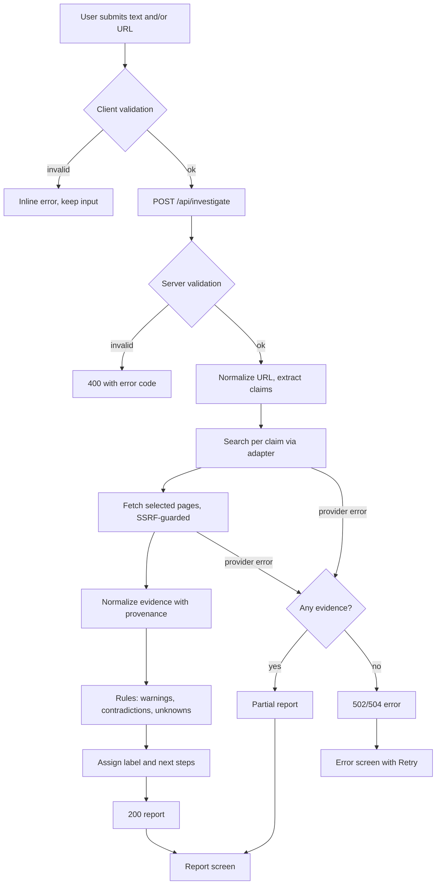
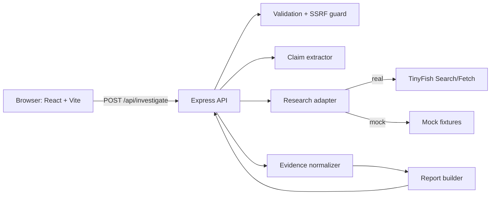

# ScamSieve: Product Requirements Document

**Version:** 0.1 (hackathon draft) · **Status:** Ready for team review

## Table of Contents
A. Overview · B. Executive Summary · C. Problem · D. Personas · E. Goals and Non-Goals · F. Scope and Priorities · G. Functional Requirements · H. User Journeys · I. UI/UX · J. Investigation Logic · K. Risk Labels and Example Report · L. Architecture · M. API Contract · N. TinyFish Integration · O. Security and Privacy · P. Data Model · Q. Error Handling · R. Non-Functional Requirements · S. Testing · T. Deployment and Demo · U. Team Plan · V. Risks · W. Roadmap · X. Final Checklist · Closing Deliverables

---

## A. Document Overview

| Item | Detail |
|---|---|
| Product | **ScamSieve**, an evidence-based scam investigation assistant |
| Summary | The user submits suspicious offer text, a URL, or both. ScamSieve gathers sourced evidence, checks the claims, and produces a report that separates *what was found*, *what looks wrong*, and *what could not be verified*. |
| Purpose | Single source of truth for building the MVP in 24 hours |
| Audience | Four beginner developers, AI coding agents, hackathon judges |
| Tags used throughout | **[CONFIRMED]** came from the project brief · **[ASSUMPTION]** a decision we made, to be validated · **[PROPOSED]** a design choice · **[FUTURE]** out of MVP scope |

**Assumptions**
- A-1: TinyFish Search and Fetch are usable with a hackathon API key. **Not yet verified.**
- A-2: One investigation may take up to ~60 s, and the UI will show progress while it runs.
- A-3: English-language input only for the MVP.
- A-4: No user accounts and no database.
- A-5: Claim extraction can be done with simple rules and optionally an LLM. See Decision 3 in the closing section.

**Terminology**

| Term | Meaning |
|---|---|
| Claim | A checkable statement in the offer ("Company X is based in Pune", "pay ₹5,000 refundable deposit") |
| Evidence | A source-backed observation with a URL, tied to a claim |
| Warning sign | A pattern commonly seen in scams. It is *not proof* of fraud. |
| Contradiction | Two pieces of evidence, or evidence and a claim, that conflict |
| Unknown | Something we tried to check and could not confirm or refute |
| Provenance | The trail showing where each piece of evidence came from |
| SSRF | Server-Side Request Forgery: tricking our server into fetching internal or private addresses |
| Adapter | A swappable module wrapping an external service (real TinyFish or mock) |

---

## B. Executive Summary

**Problem.** Students get internship, job, and scholarship messages they cannot easily verify. URL scanners say whether a *site* looks malicious, but they do not check whether the *offer's claims* hold up.

**Solution.** ScamSieve investigates both. It extracts claims from the text, searches for evidence on each, fetches relevant pages, and builds a report with citations, warning signs, contradictions, and an explicit "unknowns" section.

**Primary differentiator.** *Claim-level investigation with visible evidence and honest uncertainty*, not a black-box verdict.

**MVP demonstrates:** one end-to-end flow (submit → progress → sourced report) with real TinyFish evidence, plus a clearly labeled fallback mode.

**Elevator pitch for judges:**
> "Scam checkers tell you if a *website* is bad. But scams don't live only on websites. They live in claims: 'Pay ₹3,000 for your laptop kit', 'We're a Google partner.' ScamSieve checks those claims against the open web and shows you every source, every warning sign, and, importantly, what it *couldn't* verify. It never says 'safe'. It says what we found and what to do next."

---

## C. Problem Statement and Opportunity

**Typical scenarios [ASSUMPTION, illustrative, not statistics]**
- An internship offer arrives over WhatsApp or Telegram asking for a "registration" or "training kit" fee.
- A recruiter writes from a free email domain claiming to represent a well-known company.
- A scholarship message links to a lookalike site that asks for personal documents.
- A job posting promises very high pay for minimal work, with an interview held entirely in chat.

**Why URL reputation checks are not enough**
- A scam can be delivered by text or chat with no URL at all.
- A fresh, clean-looking domain may have no reputation history yet.
- The scam may be in the *claims* (fees, fake company identity), not in site malware.

**Limits of online evidence.** Pages may be gone, blocked, stale, or in conflict. Absence of bad news is not good news. Search results can be SEO spam. Small genuine companies may have a thin web presence.

**Facts versus assumptions.** It is a fact that URL scanners exist and focus on site reputation. We state **no prevalence or loss statistics**. The scenarios above are assumptions to validate by interviewing a few students, which is future work.

**Hackathon scope.** One pipeline: input → claim extraction → TinyFish search and fetch → evidence grouped by claim → conservative report.

---

## D. Personas

| | **Aarav, 20** | **Meera, 22** | **Rohan, 21** | **Sana, 24** |
|---|---|---|---|---|
| Background | 2nd-year B.Tech, tier-3 college | Final-year BBA, recent graduate | 3rd-year, applying to many internships | Fresh graduate, first job search |
| Pain points | Excited by brand names; doesn't know how to verify | Gets WhatsApp "HR" messages | Too many offers to vet manually | Family pressure to take any job |
| Use case | Pastes an internship message with a fee request | Pastes recruiter message plus link | Checks a URL quickly | Reviews a "work from home" offer |
| Outcome | Knows which claims are unverified before paying | Sees whether the company and recruiter identity can be confirmed | Gets a fast, cited summary | Gets next steps she can show family |
| Usability needs | Mobile-first, plain language | Easy paste of long text | Fast, skimmable top summary | Clear, non-alarmist tone |

All personas are fictional, built from assumptions.

---

## E. Goals and Non-Goals

**Primary goals**
1. Accept text and/or URL and return a structured, source-linked report.
2. Show claim-level evidence and uncertainty.
3. Be a reliable, demonstrable end-to-end flow.

**Secondary goals:** copy/export report, helpful next-steps guidance, graceful degradation.

**Measurable MVP success criteria (engineering targets, not verified capabilities)**

| ID | Criterion |
|---|---|
| SC-1 | The happy path works end to end on desktop and a 375 px viewport |
| SC-2 | ≥ 90% of the 10 prepared test inputs return a report or a clear error, with no crashes |
| SC-3 | 100% of evidence items shown have a source URL, or are explicitly labeled "no source" |
| SC-4 | Median response ≤ 45 s with real provider, ≤ 3 s with mock |
| SC-5 | Zero fabricated results shown after a provider failure |

**Non-goals.** Guaranteeing legitimacy, legally conclusive fraud findings, replacing law enforcement or cybercrime reporting, exhaustive investigation, accounts, database, multilingual support.

---

## F. Scope and Prioritization

| Priority | Features | Why | If behind schedule |
|---|---|---|---|
| **P0** | Landing + form; text/URL/both; validation; `POST /api/investigate`; TinyFish evidence (with mock fallback); structured findings and sources; warning labels; report with loading/success/failure; responsive; demo | These make the end-to-end story | Nothing here is cut. Everything else is cut first. |
| **P1** | Better claim extraction; more checks (domain age, contact consistency); source grouping/filtering; copy/export; UX polish | Improves quality | Cut in reverse order: export first, filtering second |
| **P2** | Accounts, history, database, extension, integrations, multilingual, ML, more providers | Needs infrastructure or research | Not started |

**Rule:** P1 work begins only after the P0 gate (Hour 12) passes. Cutoff for P1 is Hour 19.

---

## G. Detailed Functional Requirements

### FR-01 Landing page (P0)
- **Story:** As a student, I want to understand what the tool does before I paste anything.
- **Inputs:** none. **Output:** page with headline, 3-step explainer, "Start investigation" button, and a "what we can't do" note.
- **Edge cases:** JS disabled shows a noscript message.
- **Acceptance:**
  - AC-01.1: The CTA scrolls to or opens the form within one click.
  - AC-01.2: The page states that results are "evidence, not guarantees".
  - AC-01.3: No fake counters, badges, or "live" activity appear.

### FR-02 Offer text input (P0)
- **Precondition:** form visible. **Input:** free text, 20–5,000 characters. **Behavior:** character counter; text preserved on error.
- **Validation:** trimmed length ≥ 20 when no URL is supplied; ≤ 5,000 always.
- **Acceptance:**
  - AC-02.1: 4,999 characters accepted. 5,001 rejected with inline message.
  - AC-02.2: Whitespace-only text is treated as empty.
  - AC-02.3: Pasted HTML is rendered as plain text, never as markup.

### FR-03 URL input (P0)
- **Input:** a single URL. If the user omits the scheme, the UI may prepend `https://`.
- **Validation:** only `http`/`https` schemes; max 2,048 characters; hostname required.
- **Acceptance:**
  - AC-03.1: `javascript:alert(1)`, `file:///etc/passwd`, and `ftp://x` are rejected.
  - AC-03.2: `example.com` is normalized to `https://example.com/`.
  - AC-03.3: URLs with credentials (`user:pass@`) are rejected.

### FR-04 Text and URL together (P0)
- **Behavior:** both are sent in one request. Claims are extracted from the text, and the URL is fetched and cross-checked against them.
- **Acceptance:** AC-04.1: The report has both a "Website observations" and a "Claim findings" section. AC-04.2: If only one input is given, the other section is absent rather than empty.

### FR-05 Input validation (P0)
- **Rules:** at least one of `offerText` or `url`. Client-side validation provides fast feedback, and **server-side validation is authoritative**.
- **Acceptance:** AC-05.1: An empty submit shows "Add offer text, a URL, or both." AC-05.2: The server returns 400 with a machine-readable `code`, even if the client check is bypassed.

### FR-06 Investigation progress (P0)
- **Behavior:** a progress screen with real stages (Validating → Extracting claims → Searching → Reading sources → Building report), driven by actual completion events or, simplest, a timed indicator labeled generically.
- **Assumption:** the MVP uses a single request with a generic "Investigating…" spinner plus a stage list that is advanced honestly. If real stage events are unavailable, show only a spinner.
- **Acceptance:** AC-06.1: The submit button is disabled during the run, which prevents duplicates. AC-06.2: A cancel or "start over" control is present. AC-06.3: No fake percentages.

### FR-07 Evidence collection (P0)
- **Behavior:** the backend runs searches per claim and fetches selected pages through the adapter.
- **Acceptance:** AC-07.1: Every evidence record stores `sourceUrl`, `sourceTitle`, and `retrievedVia` (provider name). AC-07.2: Failed fetches create an "unknown" record, not an omission.

### FR-08 Claim-level findings (P0)
- **Output:** a list of claims, each with status (`supported`, `warning`, `contradicted`, `unverified`), linked evidence, and limitations.
- **Acceptance:** AC-08.1: Every claim shows at least one evidence item or the label "No sources found". AC-08.2: The status wording never says "verified" unless a source actually states it.

### FR-09 Warning signs and contradictions (P0)
- **Examples of rule-based flags:** request for upfront payment; free-email domain for a "corporate" recruiter; urgency pressure; off-platform chat interview; mismatch between company name in text and site.
- **Acceptance:** AC-09.1: Each warning cites the text snippet or source that triggered it. AC-09.2: The UI says "common warning sign", not "scam". AC-09.3: One warning alone never produces "High concern". See Section K.

### FR-10 Unknown or unverifiable claims (P0)
- **Acceptance:** AC-10.1: A dedicated "What we couldn't verify" section appears whenever any claim is unverified. AC-10.2: Each unknown includes why (no results, page blocked, conflicting).

### FR-11 Source list and links (P0)
- **Acceptance:** AC-11.1: All sources are deduplicated and shown with title, domain, and the claims they support. AC-11.2: External links use `rel="noopener noreferrer"` and open in a new tab. AC-11.3: The raw URL is displayed as text so users can see the destination.

### FR-12 Final report (P0)
- **Layout:** label and summary first, then claims, website observations, warnings, unknowns, next steps, sources, limitations.
- **Acceptance:** AC-12.1: The report includes a limitations statement. AC-12.2: Mock-mode reports carry a persistent "DEMO DATA" banner (see AC-T.2).

### FR-13 Retry and failure handling (P0)
- **Behavior:** on failure, show the error category, preserve the input, and offer **Try again**. On partial results, show what was found plus a "partial report" banner.
- **Acceptance:** AC-13.1: Retry resends the same input without retyping. AC-13.2: After a failure, no success-style content is rendered.

### FR-14 Responsive layouts (P0)
- **Acceptance:** AC-14.1: No horizontal scroll at 360 px. AC-14.2: Tap targets ≥ 44 px. AC-14.3: Report sections collapse into accordions on mobile.

### FR-15 Copy / export (P1)
- **Behavior:** "Copy report as text" using the browser clipboard; optional "Download as Markdown".
- **Acceptance:** AC-15.1: The copied text includes the sources and the limitations statement. AC-15.2: It includes the date generated, taken from the server response.

---

## H. User Journeys

**1. Student checks an internship offer.** Aarav pastes the message → the client validates → `POST /api/investigate` → the server extracts the company, fee, and contact → searches → returns a report: "Needs verification: upfront fee requested; company site found but no matching careers page." He sees the next steps: don't pay; verify via the company's official careers page.

**2. Job seeker with message + URL.** Meera adds the recruiter message and a link. The server fetches the site. The report compares the company name in the message with the site, and flags a free-email contact, with sources.

**3. Invalid URL.** The user enters `htp:/bad`. The client shows the inline error. If it is bypassed, the server returns 400 `INVALID_URL`. No investigation starts.

**4. Insufficient evidence.** Searches return nothing relevant. The report label is "Needs verification" with reason "Insufficient evidence found". The unknowns section lists each claim. The page says the absence of results is not evidence of legitimacy.

**5. Provider timeout.** The adapter times out after N seconds. The backend returns a partial report if any evidence exists, otherwise 504 `PROVIDER_TIMEOUT`. The UI shows "The research service didn't respond. Your input is saved. Try again." No invented results.

**6. Reviewing and deciding.** The user reads the summary, expands claims, opens sources, reads next steps ("Don't send money or documents; contact the company via its official site; report at cybercrime.gov.in if you've been targeted"). *Note: verify that reporting-portal reference before shipping.*





---

## I. Information Architecture and UI/UX

**Navigation:** single-page app with views `Landing → Investigate → Progress → Report` (+ Error). Use simple state-based views. A router is optional.

| Screen | Purpose / Layout | Components | Actions | States | Mobile | Accessibility |
|---|---|---|---|---|---|---|
| Landing | Explain and convert. Hero, 3 steps, limits note | Header, Hero, StepCards, LimitationsNote | Primary: Start. Secondary: view sample (labeled mock) | Static | Stacked | Heading hierarchy, contrast ≥ 4.5:1 |
| Form | Collect input. Two fields plus submit | TextArea w/ counter, UrlInput, SubmitButton, ErrorText | Submit; Clear | Inline errors, disabled while submitting | Full-width fields | Labels linked to inputs, `aria-describedby` for errors |
| Progress | Show work in progress | Spinner, StageList | Cancel | In-progress | Centered | `aria-live="polite"` region |
| Report | Present findings | SummaryCard, ClaimCard, WarningList, UnknownList, SourceList, NextSteps, Limitations | Copy; New investigation | Success, partial, empty | Accordions | Icons + text labels, keyboard-expandable |
| Error | Explain and recover | ErrorCard | Retry; Edit input | Per error code | Full width | `role="alert"` |

**Visual direction:** indigo `#4F46E5` for actions, off-white `#F8FAFC` background, navy `#0F172A` text, gray secondary. Risk labels use **text + icon + color** (for example ⚠ "Needs verification"), never color alone.

**Avoid:** fake live feeds, verification badges, shields implying certainty, confetti on "no warnings".

*Recent investigations view: skipped for MVP (no database). [FUTURE]*

---

## J. Investigation and Evidence Logic

**Pipeline**
1. **Validate** input (lengths, scheme, format).
2. **Normalize URL:** lowercase host, strip fragments, add scheme, reject credentials, resolve punycode for display.
3. **Extract clues** from the text: company names, person names, emails, phone numbers, URLs, money amounts, deadlines, payment requests, platform mentions. Start with regex and keyword rules, and optionally use an LLM constrained to return JSON, then validate its output.
4. **Search** (TinyFish Search via the adapter): queries like `"<company> official careers"`, `"<company> internship fee scam reviews"`, `"<recruiter email domain> <company>"`. Cap at ~3 queries per claim and ~8 total.
5. **Fetch** top relevant pages and the user's URL (SSRF-guarded, see O).
6. **Extract observations:** short excerpts (≤ 200 characters) that directly relate to the claim.
7. **Group by claim.**
8. **Classify** each item (below) with deterministic rules where possible.
9. **Report** with citations.
10. **Next steps** from a fixed, reviewed template library, not free-form generation.

**Evidence record** (`Evidence`)

| Field | Notes |
|---|---|
| `id` | `ev_1`… |
| `claimId` | links to a claim, or `null` for site-level evidence |
| `type` | `observed_fact` · `warning_sign` · `contradiction` · `supporting` · `unknown` |
| `category` | e.g. `payment_request`, `domain`, `company_presence`, `contact_consistency`, `reputation_mention` |
| `observation` | plain-language statement |
| `sourceTitle`, `sourceUrl` | from the provider. Never fabricated. |
| `excerpt` | verbatim text from the source or `null` |
| `retrievedAt` | only if the server actually recorded it |
| `strength` | `low` / `medium` / `high` (ordinal, not a probability) |
| `limitations` | e.g. "Page may be outdated" |
| `nextStep` | optional |

**Handling difficult situations**

| Situation | Rule |
|---|---|
| Conflicting sources | Show both, mark `contradiction`, don't pick a winner, and prefer official domains in the ordering only |
| Missing evidence | Record `unknown`. Never infer legitimacy. |
| Inaccessible page | `unknown` with reason (blocked, timeout, 4xx/5xx) |
| Stale info | Show a date only if the source gives one. Add a limitation note otherwise. |
| Unreliable sources | Down-weight forums, anonymous review sites, and content farms. Label them "user-generated or unverified source". |
| Source doesn't support claim | Excerpt-to-claim check. If no support, do not attach it as evidence. |

**Hard rules**
- No invented URLs, quotes, timestamps, or company details.
- "Supports" requires an excerpt that actually matches.
- No negatives ≠ legitimate.
- A single warning ≠ proof.

---

## K. Risk Labels and Report Design

| Label | Criteria **[PROPOSED]** | Wording |
|---|---|---|
| **High concern** | ≥ 2 independent strong warning signs (e.g., upfront payment request *and* identity mismatch), or a source-backed contradiction of a core claim | "Several significant warning signs were found. Do not pay or share documents until you verify independently." |
| **Needs verification** | Any warning sign, or key claims unverified, or insufficient evidence | "We found issues or could not confirm key claims." |
| **No major warning signs found in this check** | No warning signs, and at least some claims supported by sources | "This check found no major warning signs, but it cannot confirm legitimacy." |

Default when unsure is **Needs verification**. If the check was too thin, the report says "Insufficient evidence".

**Score:** omitted by default. If shown for the demo, label it "Experimental heuristic, not calibrated or validated," and always show the evidence next to it.

**Limitations text (always shown):** "ScamSieve reviews publicly available information at one point in time. It can miss things and can be wrong. It is not legal advice or a fraud determination."

**Example report. ILLUSTRATIVE MOCK DATA, NOT A REAL INVESTIGATION**

> **DEMO DATA, fictional company "Examplo Tech Pvt Ltd"**
> **Label:** Needs verification
> **Summary:** The message asks for a ₹4,500 "training kit" fee. The recruiter writes from a free email domain. We could not confirm an official internship listing.
>
> | Claim | Status | Evidence |
> |---|---|---|
> | "Examplo Tech is hiring interns" | Unverified | Mock: no listing found on the (fictional) company site. Limitation: site may not list roles publicly. |
> | "Pay ₹4,500 refundable fee" | Warning | Offer text contains a payment request (excerpt from the user's input). |
> | "HR contact: hr.examplo@freemail.example" | Warning | Free-mail domain. The company's (fictional) site lists a different domain. |
>
> **Unknowns:** whether the offer is genuine; whether the recruiter works there.
> **Next steps:** don't pay; contact the company via its official website; ask for an official offer letter on the company domain.

---

## L. Technical Architecture

**Responsibilities**
- **Frontend:** forms, client-side validation, API call (with `AbortController` timeout), state views, rendering the report as plain text (React escapes by default; no `dangerouslySetInnerHTML`).
- **Backend:** authoritative validation, SSRF guard, rate limiting, orchestration, normalization, report building, error mapping.
- **Provider (TinyFish):** search results and page content only.
- **Normalizer and report builder:** pure functions, easy to unit test.

**Environment variables (backend `.env`, never committed)**
`PORT`, `NODE_ENV`, `RESEARCH_MODE` (`mock` | `real`), `TINYFISH_API_KEY`, `TINYFISH_BASE_URL` (*value from verified docs*), `REQUEST_TIMEOUT_MS`, `ALLOWED_ORIGIN`. Frontend: `VITE_API_BASE_URL` only. **No secrets in `VITE_*` variables.**

**Folder structure**
```
scamsieve/
├─ docs/                      # PRD.md, tinyfish-integration-notes.md
├─ client/
│  ├─ index.html
│  └─ src/
│     ├─ main.jsx, App.jsx
│     ├─ api/investigate.js
│     ├─ components/ (InvestigationForm, ProgressView, ReportView,
│     │               ClaimCard, SourceList, ErrorCard, Banner)
│     ├─ mock/sampleReport.js  # labeled mock
│     └─ utils/validation.js
└─ server/
   ├─ package.json
   └─ src/
      ├─ index.js             # app setup
      ├─ routes/investigate.js
      ├─ validation/schema.js
      ├─ security/ssrfGuard.js, rateLimit.js
      ├─ services/
      │  ├─ claimExtractor.js
      │  ├─ evidenceNormalizer.js
      │  ├─ reportBuilder.js
      │  └─ orchestrator.js
      ├─ providers/ (researchProvider.js, tinyfishAdapter.js, mockAdapter.js)
      └─ tests/
```

**Environments:** dev uses Vite dev server with a proxy to Express. Prod serves the built client from Express (one deploy) or splits across Vercel and Render.

**Error handling:** a central Express error handler maps errors to the codes in Section M.

---

## M. API Contract

`POST /api/investigate` · `Content-Type: application/json` · max body 20 KB

**Request**
```json
{ "offerText": "string, optional, ≤5000 chars", "url": "string, optional, ≤2048 chars" }
```
At least one is required. Unknown fields are ignored or rejected (choose one and test it).

**Success response (200)**
```json
{
  "investigationId": "inv_xxx",
  "mode": "real | mock",
  "status": "complete | partial",
  "generatedAt": "ISO-8601, server-generated",
  "report": {
    "label": "high_concern | needs_verification | no_major_warnings",
    "labelText": "string",
    "summary": "string",
    "claims": [{ "id": "c1", "text": "string", "status": "supported|warning|contradicted|unverified", "evidenceIds": ["ev_1"] }],
    "websiteObservations": [ "evidenceIds..." ],
    "warnings": ["evidenceIds..."],
    "unknowns": [{ "claimId": "c1", "reason": "string" }],
    "nextSteps": ["string"],
    "limitations": ["string"]
  },
  "evidence": [{
    "id": "ev_1", "claimId": "c1",
    "type": "observed_fact|warning_sign|contradiction|supporting|unknown",
    "category": "string", "observation": "string",
    "sourceTitle": "string|null", "sourceUrl": "string|null",
    "excerpt": "string|null", "retrievedAt": "ISO-8601|null",
    "strength": "low|medium|high", "limitations": "string"
  }],
  "sources": [{ "url": "string", "title": "string", "domain": "string" }]
}
```

**Errors**

| HTTP | `code` | When |
|---|---|---|
| 400 | `EMPTY_INPUT`, `INVALID_URL`, `UNSUPPORTED_SCHEME`, `INPUT_TOO_LONG` | Validation |
| 413 | `PAYLOAD_TOO_LARGE` | Body > limit |
| 422 | `URL_NOT_ALLOWED` | SSRF guard blocked it |
| 429 | `RATE_LIMITED` | Our limiter or the provider's |
| 502 | `PROVIDER_ERROR`, `PROVIDER_INVALID_RESPONSE` | Provider failure and no usable evidence |
| 504 | `PROVIDER_TIMEOUT` | Overall timeout (e.g., 60 s, **engineering target**) |
| 500 | `INTERNAL_ERROR` | Unexpected |

Error body: `{ "error": { "code": "...", "message": "user-safe text", "retryable": true } }`

**Partial responses:** HTTP 200 with `"status":"partial"` and a limitation entry naming what failed.

**Illustrative mock request/response (MOCK, not a real provider result)**
```json
// Request
{ "offerText": "Congrats! Internship at Examplo Tech. Pay Rs 4500 training kit fee. Contact hr.examplo@freemail.example", "url": "https://examplo-tech.example" }
// Response (mock)
{ "mode": "mock", "status": "complete",
  "report": { "label": "needs_verification", "summary": "DEMO: fee requested; contact domain unverified." },
  "evidence": [{ "id": "ev_1", "type": "warning_sign", "category": "payment_request",
    "observation": "The submitted text asks for an upfront fee.", "sourceUrl": null,
    "excerpt": "Pay Rs 4500 training kit fee", "strength": "medium",
    "limitations": "Derived from the user's own text, not an external source." }] }
```

**Insufficient-evidence response (mock)**
```json
{ "mode": "mock", "status": "complete",
  "report": { "label": "needs_verification", "summary": "DEMO: no relevant sources found.",
    "unknowns": [{ "claimId": "c1", "reason": "No relevant search results" }],
    "limitations": ["Absence of results is not evidence of legitimacy."] },
  "evidence": [], "sources": [] }
```

The frontend only calls our backend. The provider key never reaches the browser.

---

## N. External Service Integration (TinyFish)

**Status: unverified.** Nothing below states TinyFish endpoints, headers, payloads, or limits. Those are intentionally left blank.

**Steps**
1. **Verify first.** Read the current official TinyFish docs for Search and Fetch. Record in `docs/tinyfish-integration-notes.md`: base URL, auth method, request/response shapes, limits, error formats, pricing/quotas, and any restrictions on fetching. Include the doc URLs and the date checked.
2. **Define the internal interface** in `researchProvider.js`: `search(query) → [{title, url, snippet}]` and `fetchPage(url) → {url, title, text, status}`.
3. **Build the mock adapter first.** The whole app runs against it.
4. **Write the TinyFish adapter** per the verified notes. Run one manual script call and save a *redacted* sample response for tests.
5. **Switch with `RESEARCH_MODE`.**
6. **Handle:** timeouts (per call and overall), 429 (do not hammer, limit retries to 1), malformed responses (`PROVIDER_INVALID_RESPONSE`), and partial results.
7. **Provenance:** every evidence item carries the provider's URL and title unchanged.

**If the service fails during judging:** (1) the UI shows an honest error and Retry; (2) the team switches to `RESEARCH_MODE=mock`, where the persistent banner reads "DEMO DATA: not a live investigation"; (3) prepare one pre-recorded real run (screenshots or video, labeled with its date) as a backup. Never present mock output as live.

---

## O. Security, Privacy, and Responsible Use

| Area | Requirement |
|---|---|
| Secrets | Server-side env only; `.env` in `.gitignore`; no keys in logs or client bundle |
| Validation / encoding | Schema validation server-side; render all text via React escaping; no `dangerouslySetInnerHTML`; strip control characters |
| **SSRF** | Fetching user URLs is risky, so (a) allow only http/https, ports 80/443; (b) resolve DNS **server-side** and block loopback (127.0.0.0/8, ::1), private (10/8, 172.16/12, 192.168/16), link-local (169.254/16 incl. cloud metadata), unspecified, multicast, and IPv6 equivalents; (c) re-validate after every redirect with a low redirect cap (e.g., 3); (d) connect to the *validated IP* to reduce DNS-rebinding risk; (e) timeouts and response-size caps; (f) text content types only; (g) preferably route fetches through the provider so our server never fetches arbitrary URLs. URL string checks alone are not sufficient. |
| Size/rate limits | Body ≤ 20 KB; per-IP rate limit (e.g., 10/min, **target**); one active investigation per client |
| Output safety | External links: `rel="noopener noreferrer"`, show the domain; never auto-open; treat fetched content as untrusted text |
| Privacy | Process in memory; no persistence; don't log offer text, emails, or phone numbers (log request ID, code, durations only); minimize what is sent to the provider (send queries, not the whole message) |
| Prompt injection | If an LLM is used, treat fetched pages and offer text as data. Constrain output to a JSON schema and validate it. |
| Responsible wording | "Warning sign" and "could not verify", never "scammer", "fraud", or "fake" about named people or companies without a source-backed basis. Always show limitations. |

---

## P. Data Model and Persistence

In-memory only, per request.

- **Submission:** `{offerText?, url?, normalizedUrl?, receivedAt}`
- **Claim:** `{id, text, kind (company|payment|contact|role|other), sourceSpan}`
- **Evidence:** per Section J
- **Investigation status:** `pending | running | complete | partial | failed` (the MVP returns the final state synchronously)
- **Report:** per Section M

**Lost on refresh:** everything. Input, report, and status. *Optional P1:* keep the last report in `sessionStorage` so a refresh does not lose it. Disclose that it is stored only in the browser.

---

## Q. Error Handling and Edge Cases

| Case | Behavior | User-facing message |
|---|---|---|
| Empty submission | 400 `EMPTY_INPUT` | "Add offer text, a URL, or both." |
| Malformed URL | 400 `INVALID_URL` | "That doesn't look like a valid web address." |
| Unsupported scheme | 400 `UNSUPPORTED_SCHEME` | "Only http and https links are supported." |
| Unreachable site | Continue; record `unknown` | "We couldn't open that website, so we couldn't check it." |
| No relevant evidence | Report with unknowns | "We found no relevant sources. That doesn't mean the offer is genuine." |
| Conflicting information | Show both, mark contradiction | "Sources disagree. Review both below." |
| Provider timeout | Partial or 504 | "The research service took too long. Try again." |
| Rate limit | 429, Retry-After if known | "Too many requests. Wait a moment and retry." |
| Partial provider response | `status: partial` | "Some checks didn't complete. This report is partial." |
| Invalid provider response | 502 or partial | "We got an unexpected response and ignored it." |
| Oversized input | 400/413 | "Please shorten the text to 5,000 characters." |
| Duplicate submission | Disable button; server may dedupe identical in-flight requests | (none) |
| Backend unavailable | Network error in the client | "We can't reach the server. Check your connection and retry." |
| Mobile network interruption | `AbortController` timeout, retry | "Connection lost. Your input is still here. Retry." |

Never show a success-style report after any failure that produced no evidence.

---

## R. Non-Functional Requirements (all engineering targets, not verified capabilities)

| Area | Target |
|---|---|
| Performance | Mock ≤ 3 s; real median ≤ 45 s; hard timeout 60 s; first paint ≤ 2 s on broadband |
| Reliability | No unhandled exceptions on the 10 prepared inputs; graceful partial results |
| Security | Section O checklist passes; zero secrets in the client bundle |
| Accessibility | Keyboard-navigable; WCAG AA contrast aimed for; labels and `aria-live`; never color alone |
| Responsive | 360 px to 1440 px without horizontal scroll |
| Maintainability | Small pure functions; one adapter interface; README with setup |
| Observability | Request ID, stage durations, and error codes logged, with no sensitive content |
| Usability | Beginner can submit and read the result in < 1 minute without instructions |
| Graceful degradation | Real → partial → honest error → labeled mock demo mode |

---

## S. Testing and QA

- **Unit:** URL normalizer, claim extractor (payment, email domain, company), SSRF guard (blocks 127.0.0.1, 10.x, 169.254.169.254, `localhost`, IPv6 loopback, redirect to private), label assignment, evidence-to-claim support check.
- **API validation:** each error code in Section M.
- **Integration:** orchestrator with the mock adapter (full report); with a failing adapter (error/partial).
- **Frontend component:** form validation, ErrorCard, ReportView rendering all states.
- **E2E happy path:** paste text → submit → progress → report with sources → copy.
- **Provider-failure tests:** timeout, 429, malformed JSON, empty results.
- **Security:** script-tag text renders inert; blocked-URL tests; oversized body.
- **Device checks:** Chrome desktop, mobile emulation at 375 px, one real phone.
- **Manual demo checklist:** env vars set; mode banner correct; backup assets ready; network tested at the venue.

**Traceability (sample)**

| Requirement | Acceptance | Test |
|---|---|---|
| FR-05 | AC-05.1, 05.2 | API-01 (empty body → 400), UI-02 |
| FR-03 | AC-03.1–03.3 | UNIT-URL-01…05 |
| FR-07 | AC-07.1, 07.2 | INT-02, INT-04 |
| FR-08/09 | AC-08.2, 09.3 | UNIT-LABEL-01…04 |
| FR-11 | AC-11.2 | UI-07 |
| FR-13 | AC-13.1, 13.2 | E2E-FAIL-01 |
| §O SSRF | n/a | SEC-01…06 |
| FR-14 | AC-14.1 | MANUAL-MOB-01 |

---

## T. Deployment and Demo

**Local setup:** `cd server && npm i && cp .env.example .env && npm run dev` · `cd client && npm i && npm run dev` (Vite proxies `/api` to the server).

**Build:** `npm run build` in the client. Option A (simplest, recommended **[PROPOSED]**): Express serves `client/dist`, a single deployment on a Node host such as Render or Railway. Option B: client on Vercel or Netlify and server on Render, with `ALLOWED_ORIGIN` and `VITE_API_BASE_URL` set. Verify free-tier cold starts before the demo and warm the server beforehand.

**Connectivity check:** a `GET /api/health` endpoint, plus a script that runs one real provider call.

**Demo data strategy:** 3 prepared inputs: (1) fee-request internship text, (2) text plus URL, (3) vague text with insufficient evidence. Record a real run as backup.

**3–5 minute script**
1. *(30 s)* Problem: "A message says pay ₹4,500 to start your internship. How do you check?"
2. *(30 s)* URL checkers only see the site, and this scam has no site.
3. *(60 s)* Paste the offer plus link and submit. Show honest progress.
4. *(90 s)* Report: label, claim-by-claim evidence, click a source, show the warning with its trigger.
5. *(45 s)* Uncertainty: the "What we couldn't verify" section and the limitations text. "We never say 'safe'."
6. *(30 s)* Failure behavior: show the honest error and mock-mode banner.
7. *(15 s)* Differentiator and future roadmap.

---

## U. Team Roles and 24-Hour Plan

**Roles**
- **Dev 1, Frontend:** UI, form, report views, API integration.
- **Dev 2, Backend:** Express, validation, routes, SSRF guard, adapter switch.
- **Dev 3, Evidence logic:** claim extractor, normalizer, labeler, report builder, TinyFish adapter, integration notes.
- **Dev 4, QA/security/research/demo:** TinyFish doc verification (first 2 hours), tests, security checks, demo script, backup assets.

**Coordination:** one repo, `main` protected, short-lived feature branches by folder ownership (`client/`, `server/routes`, `server/services`, `server/providers`). One agent per file at a time. Commit and tag a working checkpoint every hour. Merge to `main` at least every 2 hours. The **API contract in Section M is frozen at Hour 3**. Changes go through the whole team.

| Hours | Phase | Deliverables | Gate |
|---|---|---|---|
| 0–2 | Setup | Repo, scaffolds, contract frozen, TinyFish doc verification started | Both apps run "hello world" |
| 2–6 | Mock-first build | Form and report UI against mock JSON; `/api/investigate` returning a mock report | Mock end-to-end works |
| 6–12 | Real pipeline | Validation, claim extractor, adapter (verified), normalizer, labeler | **P0 gate at H12:** real or mock-with-fallback e2e |
| 12–16 | Hardening | SSRF guard, error states, rate limit, responsive fixes | Failure tests pass |
| 16–19 | P1 (optional) | Copy/export, grouping | **P1 cutoff at H19**. Unfinished work is dropped. |
| 19–21 | Deploy | Deploy, health check, device tests | Live URL works |
| 21–23 | Polish and rehearse | Demo rehearsal ×2, backup assets | Checklist green |
| 23 | **Code freeze** | Bug fixes only | n/a |
| 23–24 | Final | Last rehearsal | n/a |

---

## V. Risk Register

| Risk | L | I | Mitigation | Fallback |
|---|---|---|---|---|
| TinyFish integration uncertainty | M | H | Verify docs first; mock-first; adapter interface | Labeled mock mode and recorded real run |
| Unreliable/conflicting evidence | H | M | Source-quality notes; show both sides | "Needs verification" default |
| Hallucinated findings | M | H | Excerpt-must-match rule; deterministic rules; JSON-validated LLM output | Remove LLM step |
| Time pressure | H | H | Strict P0/P1 gates | Cut P1 |
| Integration failures | M | H | Frozen contract; hourly merges | Revert to last tag |
| Security issues (SSRF) | M | H | Guard plus tests; fetch via provider | Disable direct URL fetching |
| API quota/connectivity | M | H | Cache one real result for the demo; check venue Wi-Fi | Mock mode |
| Overly complex UI | M | M | Single flow; few components | Simplify the report |
| Conflicting edits | M | M | File ownership; short branches | Rebase and merge in pairs |
| Mock mistaken for real | M | H | Persistent "DEMO DATA" banner; `mode` field; no real-looking company names | Verbal disclosure in the demo |

---

## W. Future Roadmap

- **v1.1:** better claim extraction, copy/export, filtering, user feedback and corrections.
- **v2:** saved investigations, accounts, database, employer and domain cross-checks, additional threat-intel providers.
- **v3:** browser extension, messaging integrations, multilingual reports (Hindi first), more sophisticated classification validated on labeled data.

None of this is in the hackathon scope.

---

## X. Final Implementation Checklist

**Product completeness**
- [ ] Text-only, URL-only, and both submissions work
- [ ] Report shows label, claims, warnings, unknowns, next steps, sources, limitations

**UI/UX**
- [ ] Loading, success, partial, and error states exist
- [ ] Risk shown with text and icon, not color alone
- [ ] 375 px and desktop verified

**API integration**
- [ ] Contract matches Section M exactly
- [ ] `RESEARCH_MODE` switch works
- [ ] Integration notes file completed from official docs

**Evidence provenance**
- [ ] Every evidence item has a real source URL or an explicit "no source"
- [ ] Excerpts are verbatim
- [ ] No claim is marked supported without matching evidence

**Security**
- [ ] No secrets in the client bundle or repo
- [ ] SSRF tests pass
- [ ] Rate limit and body limit active
- [ ] No raw HTML rendering; no sensitive logging

**Testing**
- [ ] Unit, API, integration, failure, and E2E tests pass
- [ ] Traceability table filled in

**Deployment**
- [ ] Live URL tested; health check passes; env vars set

**Demo readiness**
- [ ] Three inputs rehearsed twice; backup recording ready; mock banner verified

---

## Closing Deliverables

### 1. Ten critical decisions to finalize
1. Real provider only, or mock fallback allowed during the demo (recommended: allowed, clearly labeled).
2. Single-request synchronous API versus streaming progress (recommended: synchronous for the MVP).
3. Claim extraction method: rules only, or rules plus an LLM.
4. Whether fetching goes through TinyFish only, or our server also fetches pages (recommended: provider only).
5. Whether to show any numeric score (recommended: no).
6. Deployment: single Node host versus split.
7. Overall timeout and per-call timeout values.
8. Rate-limit values.
9. Exact wording of the three labels and the limitations text.
10. Branching and file-ownership rules, and who merges.

### 2. First five implementation tasks, in order
1. Scaffold the repo (Vite client, Express server) and confirm both run.
2. Freeze the API contract and create the mock adapter with the sample fixtures.
3. Build the form with validation and the `POST /api/investigate` route returning mock results.
4. Build the report UI and the loading and error states against the mock response.
5. Complete the TinyFish verification notes, then implement the real adapter behind `RESEARCH_MODE`.

### 3. Facts to verify against current official documentation
- TinyFish Search and Fetch: base URLs, HTTP methods, auth headers, request and response schemas, error formats, rate limits and quotas, pricing, timeouts, and fetch restrictions.
- Whether a hackathon key or plan exists and its limits.
- Whether TinyFish handles redirect and private-address protections.
- The current official cybercrime reporting portal and helpline details for Indian users.
- Current free-tier limits and cold-start behavior of the chosen host.
- Any fair-use or terms-of-service constraints on displaying fetched excerpts.

### 4. Smallest acceptable working MVP
A deployed web app where a user can paste offer text and/or a URL and submit. The server validates the input, runs an investigation through the adapter (real TinyFish, or labeled mock if unavailable), and the UI displays a report with a conservative label, claim-level findings, warning signs, unknowns, source links, next steps, and a limitations statement. Invalid input and provider failures produce honest errors, and nothing fabricated is shown.

### 5. Starter prompt for an AI coding agent
> Read `docs/PRD.md` fully. Implement ScamSieve **one milestone at a time**, stopping after each for my review: (M1) scaffold client and server; (M2) mock adapter and the `POST /api/investigate` contract from Section M; (M3) form, validation, and report UI; (M4) error and partial states; (M5) real TinyFish adapter, **only after** `docs/tinyfish-integration-notes.md` is filled in from official docs. Never guess provider endpoints, fields, or limits. Never fabricate evidence, URLs, quotes, or timestamps. Keep secrets server-side. Do not edit files outside the current milestone, and do not add a database, accounts, or new services. After each milestone, list what you changed and how to test it.
