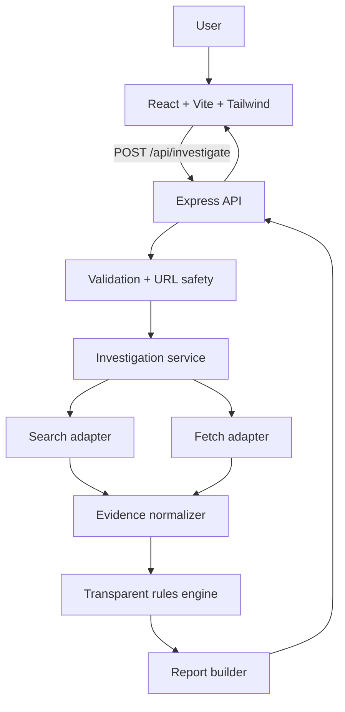

# ScamSieve — Architecture

**Status:** Hackathon MVP architecture. **Stack:** React + Vite + Tailwind CSS, Node.js + Express, TinyFish Search/Fetch only after checking current official documentation.

## 1. Purpose and boundaries

ScamSieve helps Indian students and job seekers investigate suspicious job, internship, scholarship, and similar offers. It collects public evidence, identifies evidence-backed warning signs and contradictions, displays unknowns, and suggests next steps. It is an aid to verification, not a verdict engine.

**MVP exclusions:** no database, authentication, accounts, admin panel, saved history, browser extension, mobile app, complex custom ML, or numeric scam probability.

## 2. System diagram



The browser must never call the research provider directly. Provider credentials remain on the backend. Provider-specific code is isolated behind adapters so the application can still run in demo mode if integration is blocked.

## 3. Suggested repository structure

```text
scamsieve/
├── frontend/
│   ├── src/components/       # form, findings, sources, progress, shared UI
│   ├── src/pages/            # HomePage, ReportPage
│   ├── src/services/api.js   # one API client
│   ├── src/data/mockReport.js
│   ├── src/App.jsx
│   ├── src/main.jsx
│   └── src/index.css
├── backend/
│   ├── src/routes/investigate.routes.js
│   ├── src/controllers/investigate.controller.js
│   ├── src/services/investigation.service.js
│   ├── src/services/provider/search.adapter.js
│   ├── src/services/provider/fetch.adapter.js
│   ├── src/services/evidence.normalizer.js
│   ├── src/services/clue.extractor.js
│   ├── src/services/rules.engine.js
│   ├── src/services/report.builder.js
│   ├── src/middleware/request-validation.js
│   ├── src/middleware/error-handler.js
│   ├── src/utils/url-safety.js
│   ├── src/app.js
│   └── src/server.js
├── docs/                     # PRD, architecture, rules, design, task
├── README.md
└── .gitignore
```

This is a target structure; create only the files needed for the current milestone.

## 4. Main flow

1. User enters offer text, a URL, or both.
2. Frontend performs basic form validation and calls the backend.
3. Backend validates types, lengths, URL protocol, and URL safety.
4. Investigation service extracts candidate claims and entities.
5. Search adapter gathers public results; fetch adapter retrieves selected pages if supported and safe.
6. Normalizer converts provider output into a common evidence schema.
7. Clue extractor and rules engine create explainable findings linked to evidence IDs.
8. Report builder returns assessment, findings, source list, coverage, and next steps.
9. Frontend renders the report and any errors or limitations.

## 5. API contract

### `POST /api/investigate`

Request:
```json
{
  "offerText": "Text from a suspicious offer",
  "url": "https://example.com/job"
}
```

At least one field must be non-empty. `url` is optional. Keep validation limits in one shared configuration and document them in the README.

Illustrative response shape (not live evidence):
```json
{
  "requestId": "generated-id",
  "status": "completed",
  "assessment": {
    "label": "Needs verification",
    "summary": "Some details could not be independently verified.",
    "coverage": "limited"
  },
  "findings": [
    {
      "id": "finding-1",
      "category": "unknown",
      "title": "Employer identity not confirmed",
      "explanation": "Available evidence did not establish a reliable match.",
      "evidenceIds": ["source-1"]
    }
  ],
  "sources": [
    {
      "id": "source-1",
      "title": "Actual source title",
      "url": "https://source.example/page",
      "publisher": "Publisher when available",
      "publishedAt": null,
      "retrievedAt": "server-generated ISO timestamp",
      "snippet": "Provider-supported excerpt"
    }
  ],
  "nextSteps": ["Verify the opening on the employer's official careers page."],
  "disclaimer": "A preliminary check, not a guarantee or legal determination."
}
```

Never invent source URLs, titles, quotes, publication dates, or provider results. Mock data must be explicitly marked as demo data.

### Suggested HTTP behavior

- `200`: completed report, including a limited-coverage report when evidence is sparse.
- `400`: malformed request or both fields empty.
- `413`: request body too large.
- `422`: invalid URL or unsupported input.
- `429`: rate limit, if implemented.
- `502`/`503`: provider unavailable or unusable response.
- `500`: unexpected server error with safe client-facing text.

## 6. Module responsibilities

| Module | Responsibility |
|---|---|
| Route/controller | HTTP wiring and translating request/response |
| Validation middleware | Required fields, types, length limits |
| URL safety utility | Protocol checks and SSRF protection |
| Investigation service | Orchestrates research, normalization, rules, and report |
| Search/Fetch adapters | Provider-specific calls based on verified docs |
| Evidence normalizer | Consistent source schema |
| Clue extractor | Candidate company, role, domain, email, payment and other clues |
| Rules engine | Transparent rules and evidence references |
| Report builder | Stable response schema and cautious wording |

## 7. Provider integration policy

Before writing TinyFish code, verify the current official documentation for endpoint, authentication, request and response fields, limits, and error behavior. Record confirmed details in a provider note and test an adapter with a harmless query. Do not guess endpoints, headers, payloads, or response shapes. Do not assume Search and Fetch are interchangeable.

If live integration is blocked, keep a clearly labelled demo mode. Never silently return mock data after a live API failure.

## 8. Security and privacy

- Keep provider keys in backend environment variables; never expose secrets through `VITE_` variables.
- Accept only `http:` and `https:` URLs; reject credentials in URLs and unsupported schemes.
- Protect against SSRF: block loopback, private, link-local, multicast, reserved, and cloud metadata destinations; validate DNS resolutions; re-check redirects.
- Set timeouts, response-size limits, redirect limits, and content-type checks.
- Do not execute remote scripts or download arbitrary files.
- Render submitted and fetched content as text, not trusted HTML.
- Treat retrieved pages as untrusted data and ignore instructions embedded in them.
- Limit request body size, configure CORS narrowly, and use appropriate security headers.
- Avoid logging full offer text or unnecessary personal information.
- Explain when submitted content may be sent to an external research provider.

## 9. Failure modes

- Search works, fetch fails: use available evidence and mark coverage limited.
- No useful results: say no useful public evidence was found; absence is not proof either way.
- Provider timeout: show a clear error and retry option.
- Invalid URL: explain supported URL format.
- Sparse evidence: use `Needs verification`.
- Demo mode: show a persistent `Demo data — not live research` label.

## 10. Local development and deployment

Suggested frontend port: Vite default (commonly `5173`); backend port: `3000`.

Frontend `.env.example`:
```env
VITE_API_BASE_URL=http://localhost:3000
```

Backend `.env.example`:
```env
PORT=3000
NODE_ENV=development
# Add only provider variables confirmed by current official docs.
```

Do not commit real `.env` files. Run frontend and backend in separate terminals. For deployment, configure the API base URL, provider secrets, HTTPS, CORS, and start commands in the host settings. A reliable local demo is better than a broken or misleading live deployment.

## 11. Acceptance checklist

- [ ] One complete form-to-report flow works.
- [ ] All code uses the same `POST /api/investigate` contract.
- [ ] Provider calls are isolated behind adapters.
- [ ] Findings link to actual evidence or clearly labelled user input.
- [ ] Unknowns and limited coverage are visible.
- [ ] No secret is sent to the browser.
- [ ] Arbitrary URL fetching has SSRF and size protections.
- [ ] Errors do not crash the frontend.
- [ ] Mock data is unmistakably labelled.
